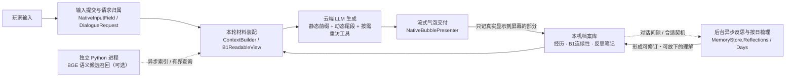

# LilithBridge 架构入门：从第一性原理到长期相处

> 你不需要安装游戏或通读 C# 代码才能看懂这篇文档。如果想直接上手使用，请先移步[安装与使用指南](NORMAL-USE.zh-CN.md)。

LilithBridge 连接着三样东西：**桌面上活生生的游戏角色（Lilith）**、**大语言模型（LLM）**，以及一套围绕真实相处设计的**本机长期记忆机制**。

市面上常见的做法，是把“多轮对话列表 + 向量库 Top-K 搜索结果”直接拼进系统提示词。短时间聊几句很热闹，可只要相处超过几天，就会撞上几个绕不过去的根本问题：模型被切碎的旧台词淹没、把从未说完的草稿当成共同记忆、被一两条旧标签锁死性格，或者搜不到跨词跳跃的灵感火花。

这套架构的设计，就是为了从第一性原理正面回应这些问题。

---

## 一、核心图景：前台流畅聊，后台慢慢想

为了不让记忆检索与整理拖慢日常对话，LilithBridge 把一次交互拆成了**两条节奏完全不同的通路**：

这个结构决定了几个很实际的特性：**日常聊天几乎总是一步直答**，不必每轮强制走完工具链或等后台做总结；你可以随时发新话**打断**她还没说完的气泡；本地小模型（可选）放在独立进程里按意思帮忙找旧事，就算一时繁忙或未开启，主对话照样顺畅进行。

---

## 二、支撑这套架构的四个核心思想

用一个简单例子贯穿下面四点：前几天你顺嘴说过“周六想去旧书店看看”，今天下午你只说了一句“忙完了，终于空下来”。

### 原则 1：输出气泡只是呈现手段，不是记忆的最小单元

传统流式 MOD 很容易踩一个坑：为了支持气泡分句播放和玩家随时插话，把模型返回的整段话按气泡拆成 10～20 条记录分别写库。如果后续直接拿这些散落记录去检索和拼装上下文，模型眼前就会塞满来自同一分钟、同一句话的几十片残缺“回声”，既挤占上下文，又容易产生“她说了一堆重复碎话”的错觉。

LilithBridge 在工程上把**呈现与记忆拆解为两件事**：
- **交付时按实落盘**：[`NativeBubblePresenter.cs`](src/LilithBridge/NativeBubblePresenter.cs) 与 [`BridgeController.Delivery.cs`](src/LilithBridge/BridgeController.Delivery.cs) 只把真正成功展示在屏幕上的内容写进助手历史；若你在她说到一半时插话，未播出的后半句绝不会混进“我们聊过的话”里。
- **供给时按轮归并**：通过 [`HistoryProjection.cs`](src/LilithBridge/HistoryProjection.cs) 与 [`B1ReadableView.cs`](src/LilithBridge/B1ReadableView.cs)，原本为了视觉播放被切开的同一轮气泡，在供模型阅读时会自动重新拼回完整、连贯的段落；同时识别并折叠已经在近期窗口或召回区出现过的同源内容，不再一式多份地反复念叨。

### 原则 2：把“事实经历”和“主观理解”分账，允许修正、推翻和放下

如果把所有记忆都压成一句话概括或固定好感度标签，只要你说一句“算了，今天太累不想出门了”，系统要么僵硬地追问“可你上次不是期待去旧书店吗”，要么直接给你改写成“不喜欢书店”。

我们在存储和读取上把几类账分得很清楚：

| 账本类型 | 存的是什么 | 在旧书店例子里扮演的角色 | 设计用意 |
|---|---|---|---|
| **对话与经历归档** | 玩家发言、真实显示出来的回复、时间与更正链 | 原样记下“周六想去旧书店”与“今天不想出门” | 原始事实不可伪造，也不因后来写总结而被覆盖改写 |
| **B1 连续性理解** | 带来源依据的观察、判断或悬而未决的问题（`v4-b1-continuity-v2.sqlite3`） | 若模型觉得有意义，可在回复末尾悄悄记下一笔可重看的判断（`<b1>`） | 不打断眼前交流，每条判断都绑定实际引用的材料出处（`ShortRefs`） |
| **反思记录与做法** | 后台在合适间隙形成的想法笔记、经验做法与关系理解 | 体会到“他期待出门，但也更在意当天精力”，且以后随时能改 | **明确标出生命周期**：支持修订（`revises`）与温和收起（`settles`），不变成对玩家定性的硬规定 |

这就是为什么我们能比较有底气地说：**记忆在这里不是为了给用户画像、打死标签，而是为了让每一次重新理解都有依据、有余地。**

### 原则 3：“搜得宽”与“判得准”分离——既过四道筛，也留住跳跃联想的火花

检索增强（RAG）常见两种极端：阈值收得太窄，只有字面一模一样才捞得出来，遇到换种说法或者意象迁移（比如因为聊起某种处境联想到另一本完全没提相同词汇的小说）就直接失明；阈值放得太宽，垃圾噪音又会把真正重点淹没。

LilithBridge 把工作分给两个阶段：
1. **多路候选先求全**：**词面检索**抓取人名、专有词、时间与明确更正关系；可选的 **BGE 本地语义召回**（独立 Python worker）负责把“意思接近、换了词说”的片段找出来。
2. **四重边界校验后交由模型亲判**：
   - **来源可用**：是否仍在许可范围内（如作品库外发授权、长期记忆开关），不混淆“谁说过的话”；
   - **版本有效**：若某句原话已被你明确更正或撤回，不能只因字面像就拿去当新依据；
   - **关联与容量**：优先保证关键上下文不从意思中间腰斩；
   - **最后交由模型判断**：程序**不会**内置一条死规则规定“只要命中书店经历就必须催他去”；你今天只是想喘口气，莉莉丝可以主动接住这份疲惫，也可以只在心底记得那家店还在那里。

需要更早、更细的上下文或想法原文时，模型还可以按需主动使用 `review_context` 与 `revisit_thought` 工具去翻看完整上下文，而不是每次闲聊都扛着整本历史硬着头皮回答。

### 原则 4：兼顾前缀缓存稳定性与注意力的分层装配

大模型既吃“注意力分布”（长文本往往首尾清晰、中段容易散），也吃现代推理服务的“前缀 KV 缓存命中率”（提示词前段只要变动一个字，整段长上下文就要重新计算一遍，既慢又贵）。

因此请求组织采用**固定前段 + 锚定窗口 + 动态尾段**的分层策略：
- **静态前段尽量不动**：系统角色定位、规则说明以及工具定义（如 `revisit_thought` 的静态结构）保持稳定；
- **近期对话锚点步进**：通过 [`MemoryStore.NativeDialogueSupply.cs`](src/LilithBridge/MemoryStore.NativeDialogueSupply.cs) 中的历史锚点机制按步长平滑推进，避免每新增一轮就把整个前缀起点向前挪一步，显著降低重复首字等待时间；
- **动态材料与当下发言放在尾部**：本轮召回经历、`B1` 拼合材料、可选重访线索与你刚敲出的那一句话落在注意力集中的尾段，让她先听清你此刻在说什么，再借助材料回响自然接话。

---

## 三、架构的边界：把“还能做得更好”的地方也摆在明面上

在强调这些设计思路的同时，我们也清楚当前架构仍有一些真实限制与正在打磨中的方向：

1. **相关性与整段预算仍在持续平衡**：将几十片气泡合并回整段后，如果一段早期长回复（五六百字）只有局部跟当前话题相关，整段放进 `B1` 材料区仍然可能较快用满材料预算。接下来计划逐步探索更合理的**多粒度供给**（近轮给整轮对话、相关往事给线索摘要、远距离火花只给简短原话与“为什么它出现在这里”的附注）。
2. **后台不是绝对实时，也没有百分百“不遗漏”的保证**：后台反思和语义索引均有冷却、状态与预算保护；检索、模型理解、显示中断中的任意一环有波动，都可能漏掉本该想起的细节。
3. **跨作与原生互动的边界**：“一起看”等实验模块虽在源码中逐步铺设，目前仍未作为稳定默认日常能力宣传；对官方游戏状态的接管也以不破坏原有剧情与存档安全为第一前提。
4. **游戏接口兼容验证是静态+实机结合的**：安装器中的 [`HostCapabilities.cs`](tools/installer-source/src/HostCapabilities.cs) 会逐项核对运行所需的游戏与加载器静态签名（这也是游戏小更新时常常无需重写整套逻辑的原因），但签名满足并不替代实际游玩的体验验收。

---

## 四、源码导航：想看哪块，从哪里读最省力

所有主要 C# 文件都位于 [`src/LilithBridge/`](src/LilithBridge/)（`BridgeController` 与 `MemoryStore` 按职责拆在多个 `partial` 文件里，编译时属于同一个类）：

| 你想了解的环节 | 推荐阅读入口 |
|---|---|
| 插件如何接入游戏、监听原生事件 | [`Plugin.cs`](src/LilithBridge/Plugin.cs) → [`NativeHooks.cs`](src/LilithBridge/NativeHooks.cs) → [`BridgeController.cs`](src/LilithBridge/BridgeController.cs) |
| 输入提交、对话切换与中断归属 | [`NativeInputField.Submission.cs`](src/LilithBridge/NativeInputField.Submission.cs) → [`BridgeController.InputSubmission.cs`](src/LilithBridge/BridgeController.InputSubmission.cs) → [`DialogueRequest.cs`](src/LilithBridge/DialogueRequest.cs) |
| 材料怎么挑、历史锚点怎么稳缓存 | [`ContextBuilder.cs`](src/LilithBridge/ContextBuilder.cs) → [`HistoryProjection.cs`](src/LilithBridge/HistoryProjection.cs) → [`MemoryStore.NativeDialogueSupply.cs`](src/LilithBridge/MemoryStore.NativeDialogueSupply.cs) |
| 气泡拼合、跨区去重与 `B1` 连续性 | [`B1ReadableView.cs`](src/LilithBridge/B1ReadableView.cs) → [`GeneratedReplyMaterial.cs`](src/LilithBridge/GeneratedReplyMaterial.cs) → [`MemoryStore.B1.Storage.cs`](src/LilithBridge/MemoryStore.B1.Storage.cs) |
| 词面检索、权限范围与更正关系 | [`MemoryStore.Experiences.cs`](src/LilithBridge/MemoryStore.Experiences.cs) → [`SourcePermissionScope.cs`](src/LilithBridge/SourcePermissionScope.cs) → [`MemoryStore.SupplyContract.cs`](src/LilithBridge/MemoryStore.SupplyContract.cs) → [`MemoryStore.SourceCorrections.cs`](src/LilithBridge/MemoryStore.SourceCorrections.cs) |
| 本地 BGE 语义召回进程桥接 | [`BridgeController.SemanticRecall.cs`](src/LilithBridge/BridgeController.SemanticRecall.cs) → [`SemanticRecallWorker.cs`](src/LilithBridge/SemanticRecallWorker.cs) → [`semantic_worker.py`](optional/semantic-worker/semantic_worker.py) |
| 模型请求拼装、工具与来源封装 | [`DeepSeekClient.cs`](src/LilithBridge/DeepSeekClient.cs) → [`DeepSeekClient.Tools.cs`](src/LilithBridge/DeepSeekClient.Tools.cs) → [`DialogueMaterialEnvelope.cs`](src/LilithBridge/DialogueMaterialEnvelope.cs) |
| 哪些字真正在屏幕上说完并写回 | [`NativeBubblePresenter.cs`](src/LilithBridge/NativeBubblePresenter.cs) → [`BridgeController.Delivery.cs`](src/LilithBridge/BridgeController.Delivery.cs) |
| 后台反思、按日整理与按需重访 | [`BridgeController.ReflectionPreparation.cs`](src/LilithBridge/BridgeController.ReflectionPreparation.cs) → [`MemoryStore.Reflections.cs`](src/LilithBridge/MemoryStore.Reflections.cs) → [`MemoryStore.ExplicitRevisit.cs`](src/LilithBridge/MemoryStore.ExplicitRevisit.cs) |
| 主动开场与会话场景状态 | [`RuntimeDirector.cs`](src/LilithBridge/RuntimeDirector.cs) → [`BridgeController.Participation.cs`](src/LilithBridge/BridgeController.Participation.cs) → [`SelfPositionView.cs`](src/LilithBridge/SelfPositionView.cs) |
| 隔离数据目录、配置与底层存储 | [`DataPaths.cs`](src/LilithBridge/DataPaths.cs) → [`ConfigStore.cs`](src/LilithBridge/ConfigStore.cs) → [`NativeState.cs`](src/LilithBridge/NativeState.cs) |
| 一体化安装器与兼容性安全门 | [`Installer.Core.cs`](tools/installer-source/src/Installer.Core.cs) → [`HostCapabilities.cs`](tools/installer-source/src/HostCapabilities.cs) → [`PersistentStateCompatibility.cs`](tools/installer-source/src/PersistentStateCompatibility.cs) |

---

[回到首页](README.md) · [安装与使用指南](NORMAL-USE.zh-CN.md) · [可选召回依赖](docs/DEPENDENCIES.md) · [技术与环境范围](docs/TECHNICAL-NOTES.md)
