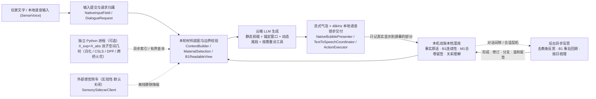

# LilithBridge 架构入门：从第一性原理到长期相处

> 你不需要安装游戏或通读 C# 代码才能看懂这篇文档。如果想直接上手使用，请先移步[安装与使用指南](NORMAL-USE.zh-CN.md)。

LilithBridge 连接着三样东西：**桌面上活生生的游戏角色（Lilith）**、**大语言模型（LLM）**，以及一套围绕真实长期相处设计的**本机连续性记忆架构**。

市面上常见的做法，是把“多轮对话列表 + 向量库 Top-K 搜索结果”直接拼进系统提示词，再叠上好感度数值、静态标签或人造遗忘曲线来演“像真人”。短时间聊几句很热闹，可只要相处超过几天，就会撞上几个绕不过去的根本问题：模型被切碎的旧台词和旧长文淹没、把从未说完的草稿当成共同记忆、被一两条旧标签锁死性格、被硬编码规则替角色抢话，或者搜不到跨词跳跃的灵感火花。

这套架构的设计，就是为了从第一性原理正面回应这些问题：**不搞仿生学，不让程序替模型说话，用干净的结构托住真实的思想连续性。**

---

## 一、核心图景：前台流畅聊，后台慢慢想

为了不让记忆检索与整理拖慢日常对话，LilithBridge 把一次交互拆成了**两条节奏完全不同的通路**：

这个结构决定了几个很实际的特性：**日常聊天几乎总是一步直答**，不必每轮强制走完工具链或等后台做总结；你可以随时发新话或开麦**打断**她还没说完的气泡；可选的本地语义与离线语音均在受 Job Object 托管的独立子进程里运行，就算未安装或一时繁忙，主对话照样顺畅进行，退出游戏零残留。

---

## 二、支撑这套架构的四个核心思想

用一个简单的日常场景贯穿下面四点：前几天你顺嘴说过“周六想去旧书店看看”，今天下午你只说了一句“忙完了，终于空下来”。

### 原则 1：呈现与记忆解耦——气泡只是演出，交付实录才是历史

传统流式 MOD 很容易踩两个坑：一是把整段长回复按气泡拆成十几条散落记录直接塞回上下文，让模型眼前堆满同一句话的残片；二是把被打断未播出的草稿，或者工具调用期间的过渡表达，长期混进共同记忆里。

LilithBridge 在工程上把**屏幕呈现**与**历史记忆**彻底拆开：
- **交付时按实落盘**：[`NativeBubblePresenter.cs`](src/LilithBridge/NativeBubblePresenter.cs) 与 [`BridgeController.Delivery.cs`](src/LilithBridge/BridgeController.Delivery.cs) 只把真正成功展示在屏幕上的内容写进助手历史；你中途插话时，未播出的后半句绝不会冒充“我们聊过的话”。
- **残稿与临时表达限时退役**：[`GeneratedReplyMaterial.cs`](src/LilithBridge/GeneratedReplyMaterial.cs) 将未播完残稿收敛在紧邻下一轮短暂承接（`T → T+1`，到 `T+2` 自然退役，不再隔几天翻旧残稿考古）；检索期产生的临时过渡气泡在承接轮完整交付后通过 [`NativeWorkPlayback.cs`](src/LilithBridge/NativeWorkPlayback.cs) 自动退役，同时完整保留权限链的传递撤回能力。
- **供给时按轮无损归并**：通过 [`HistoryProjection.cs`](src/LilithBridge/HistoryProjection.cs) 与 [`B1ReadableView.cs`](src/LilithBridge/B1ReadableView.cs)，为视觉播放拆开的多片气泡在供模型阅读时会重新拼回连贯段落，并折叠重复同源引用、去掉冗余的机械标注，保持上下文干净紧凑。

### 原则 2：事实与理解分账——不搞仿生学，做真实的思想连续性

如果把所有记忆压成固定好感度或几条静态画像，再套上一套人造遗忘曲线，只要你说一句“算了，今天太累不想出门”，系统要么僵硬追问，要么粗暴覆盖你的画像，要么靠倒计时“演失忆”。

我们在存储和演化机制上把“发生过什么”和“她怎么理解”拆得清清楚楚：

| 账本类型 | 存的是什么 | 在旧书店例子里扮演的角色 | 设计用意 |
|---|---|---|---|
| **事实经历归档** | 玩家发言、真实显示到屏幕的回复、时间与更正链 | 原样记下“周六想去旧书店”与“今天太累不想出门” | 原始事实不可伪造，也不因后来写总结而被覆盖改写 |
| **B1 连续性理解** | 带来源出处与防篡改校验的个人判断或悬而未决的念头（`v4-b1-continuity-v2.sqlite3`） | 当场或聊完回看时记下一笔有依据的判断，并随着新对话演进 | 支持跨会话延续，通过 `B1EntryPermissionFootprint` 精确核算引用权限，不被无关环境台词误杀 |
| **反思笔记、做法与关系理解** | 后台间隙沉淀的想法笔记、经验法则与对这段关系的主观理解（`Readings`） | 体会到“他期待出门，但也更在意当天精力”，且以后随时能改 | **明确生命周期**：可修订（`revises`）、可按情境分支（`qualify`）、可温和收起（`settles`），而非永久定性的硬标签 |

更关键的是 `v0.4` 引入的 **B1 事后回顾反思（Experience-Anchored Retrospective Development）**：
- 通过 [`MemoryStore.B1.Reconsideration.cs`](src/LilithBridge/MemoryStore.B1.Reconsideration.cs)、[`MemoryStore.B1.ReflectionFlow.cs`](src/LilithBridge/MemoryStore.B1.ReflectionFlow.cs) 与 [`DeepSeekClient.B1Reflection.cs`](src/LilithBridge/DeepSeekClient.B1Reflection.cs)，后台会在对话停歇的空隙里按**完整问答边界**切片回看近期交流，用严格 `[0, 1]` 有界的双口径词法打分（长文阻尼 `UserLexScore` + 几何均值 `OchiaiScore`）配合语义与情境条件锁定相关旧念头，让想法在真实经历的推动下自然形成、修订或分支并存——既不需要人造遗忘曲线，也不允许后台越权篡改原始事实或凭空伪造玩家发言。
- 同时，关系理解（`Readings`）已纳入本地语义索引，结合 [`MemoryStore.MaterialSelection.cs`](src/LilithBridge/MemoryStore.MaterialSelection.cs) 在话题或情绪对味时通过直中或锚点共激活自然浮现，在纯打招呼与日常琐事里保持克制。

### 原则 3：宽召回与严边界分离——绝不让程序替模型说话

检索增强（RAG）常见两种极端：阈值过窄，换种说法就彻底失明；阈值过宽，背景噪音和几千字旧长文会把眼前正题淹没。更糟糕的是用程序硬规则写死“召回到 A 就强制回复 B”，把角色变成提线木偶。

LilithBridge 严格把“找线索”和“做判断”拆给两层：
1. **几何语义 + 词面多路宽召回**：
   - **词面检索**（[`MemoryStore.Experiences.cs`](src/LilithBridge/MemoryStore.Experiences.cs)）精准抓取人名、专有词、时间与明确更正关系，并对旧长文施加平滑长度阻尼，防止一两篇长谈话反复霸占名额；
   - **可选本地 BGE 双子空间几何召回**（[`semantic_worker.py`](optional/semantic-worker/semantic_worker.py) + [`SemanticRecallWorker.cs`](src/LilithBridge/SemanticRecallWorker.cs)）在独立进程里运行 `bge-small-zh-v1.5`，将记忆投影到**具象经历（`X_exp`）与抽象默契（`X_abs`）双子空间**，分别执行自适应收缩白化、自适应 CSLS 校准、Gram-Schmidt 场景锥新颖度计算、DPP 多样性去冗余与两跳 `BridgeSparks` 跨桥联想（配合全精度 `SemanticWireCodec` 与 `Readings` `DomainRank` 守护），既避免意思雷同的旧话反复刷屏，也能捞出跨越字面的跨天共鸣；
   - **历史旧档 M1 合卷留签**：对于此前版本沉淀的历史旧笔记与经验教条，通过 [`MemoryStore.Reflections.cs`](src/LilithBridge/MemoryStore.Reflections.cs) 的无损合卷前缀隔离日常闲聊噪声，同时保留显式追问与主动重访入口。
2. **四重边界校验后交由模型亲判**：
   - **来源与权限**：严格校验可见范围与授权边界（记忆开关、作品语料外发许可、不混淆说话人）；
   - **版本与更正链**：已被玩家明确更正或撤回的原话不会继续充当有效依据；
   - **显著度与噪声门控**：遵循寒暄过滤与几何显著度门控（`SalienceGated`），拒绝把背景嗡嗡声塞进上下文；
   - **判断权完全归模型**：程序**绝不替模型说话**——今天你只是想喘口气，莉莉丝可以接住你的疲惫，也可以顺嘴提起那家旧书店，或者干脆什么都不提只陪你发会儿呆。

需要更早、更细的上下文或想法原文时，模型还可以按需主动调用 `review_context` 与 `revisit_thought` 工具去翻阅完整记录，而不必每次闲聊都背着整本历史硬聊。

### 原则 4：结构压倒修辞——前缀 KV 缓存、上下文信噪比与后台韧性

实践一再证明：**干净的上下文结构，远比往系统提示词里狂塞几千字规则有效。** 只要上下文底部充斥着臃肿杂音和自我否定的合规套话，顶部的角色设定再精美也会被瞬间带偏；同时现代大模型推理高度依赖前缀 KV 缓存，前段变动一个字就会导致整段长上下文重算。

因此请求组织遵循严格的工程纪律：
- **静态前段 + 锚定窗口 + 动态尾段**：固定系统定位与静态工具定义不动；[`MemoryStore.NativeDialogueSupply.cs`](src/LilithBridge/MemoryStore.NativeDialogueSupply.cs) 通过步进式历史锚点平滑推进近期对话，保护前缀 KV 缓存命中率；本轮动态召回、`B1` 拼合材料、去重瘦身后的主观参考块（标题规范同步至 [`ReplySanitizer.cs`](src/LilithBridge/ReplySanitizer.cs)）以及你刚敲出的那一句话落在注意力集中的尾段。
- **传输保活与后台防卡死**：[`DeepSeekClient.cs`](src/LilithBridge/DeepSeekClient.cs) 与 [`OpenAIProtocol.cs`](src/LilithBridge/OpenAIProtocol.cs) 使用带连接保活池的 `SocketsHttpHandler` 减少闲置后的偶发断连；后台反思强制启用结构化 `json_object` 协议并在连续异常拒收时安全释放任务，确保后台异常绝不拖垮或阻塞前台聊天。

---

## 三、架构边界与实验性方向

在讲清核心设计的同时，我们也把当前的真实边界与正在探索的方向摆在明面上：

1. **多粒度材料预算仍在持续打磨**：气泡按轮归并后，若一段早期长对话只有局部与眼前话题相关，整段带入仍可能较快消耗材料预算。未来会继续打磨“近轮完整对话 + 往事线索摘取 + 远距离轻量火花”的多粒度供给策略。
2. **后台非绝对实时，也受限于模型本身能力**：后台反思、B1 回顾与语义索引均有冷却、状态与预算保护，检索与生成任何一环的波动都可能导致遗漏细节——我们的底线是**每条理解有源可溯、有错可改**，而非伪装全知全能。
3. **实验性模块（Experimental）**：
   - **外部桌面感官侧车（Sensory Sidecar）**：源码已预留独立的回环宿主客户端与微反应节律协同（[`SensorySidecarClient.cs`](src/LilithBridge/SensorySidecarClient.cs)、[`BridgeController.Sensory.cs`](src/LilithBridge/BridgeController.Sensory.cs)、[`MicroReactionDirector.cs`](src/LilithBridge/MicroReactionDirector.cs)），目前仍处于**实验性阶段**、默认关闭，离线时静默降级，绝不影响正常聊天体验；
   - **“一起看”与原生互动扩展**：同样保持渐进式探索，以不破坏官方游戏剧情与存档安全为第一前提。
4. **游戏更新兼容验证是静态签名 + 实机结合**：安装器里的 [`HostCapabilities.cs`](tools/installer-source/src/HostCapabilities.cs) 会逐项核对运行所需的游戏类型与成员签名，但静态检查通过并不替代实际游玩的体验验收。

---

## 四、源码导航：想看哪块，从哪里读最省力

所有主要 C# 源码均位于 [`src/LilithBridge/`](src/LilithBridge/)（`BridgeController` 与 `MemoryStore` 按职责拆分为多个 `partial` 文件）：

| 你想了解的环节 | 推荐阅读入口 |
|---|---|
| 插件如何接入游戏、监听原生事件 | [`Plugin.cs`](src/LilithBridge/Plugin.cs) → [`NativeHooks.cs`](src/LilithBridge/NativeHooks.cs) → [`BridgeController.cs`](src/LilithBridge/BridgeController.cs) |
| 输入提交、对话切换与中断归属 | [`NativeInputField.Submission.cs`](src/LilithBridge/NativeInputField.Submission.cs) → [`BridgeController.InputSubmission.cs`](src/LilithBridge/BridgeController.InputSubmission.cs) → [`DialogueRequest.cs`](src/LilithBridge/DialogueRequest.cs) |
| 上下文装配、关系理解供给与历史锚点 | [`ContextBuilder.cs`](src/LilithBridge/ContextBuilder.cs) → [`MemoryStore.MaterialSelection.cs`](src/LilithBridge/MemoryStore.MaterialSelection.cs) → [`HistoryProjection.cs`](src/LilithBridge/HistoryProjection.cs) → [`MemoryStore.NativeDialogueSupply.cs`](src/LilithBridge/MemoryStore.NativeDialogueSupply.cs) |
| 气泡拼合、残稿收敛与 `B1` 发现／投影 | [`B1ReadableView.cs`](src/LilithBridge/B1ReadableView.cs) → [`GeneratedReplyMaterial.cs`](src/LilithBridge/GeneratedReplyMaterial.cs) → [`MemoryStore.B1.Discovery.cs`](src/LilithBridge/MemoryStore.B1.Discovery.cs) → [`MemoryStore.B1.Projection.cs`](src/LilithBridge/MemoryStore.B1.Projection.cs) |
| `B1` 存储、权限足迹与事后回顾反思 | [`MemoryStore.B1.cs`](src/LilithBridge/MemoryStore.B1.cs) → [`MemoryStore.B1.Storage.cs`](src/LilithBridge/MemoryStore.B1.Storage.cs) → [`MemoryStore.B1.Reconsideration.cs`](src/LilithBridge/MemoryStore.B1.Reconsideration.cs) → [`MemoryStore.B1.ReflectionFlow.cs`](src/LilithBridge/MemoryStore.B1.ReflectionFlow.cs) → [`DeepSeekClient.B1Reflection.cs`](src/LilithBridge/DeepSeekClient.B1Reflection.cs) |
| 词面检索、长文阻尼、权限范围与更正链 | [`MemoryStore.Experiences.cs`](src/LilithBridge/MemoryStore.Experiences.cs) → [`SourcePermissionScope.cs`](src/LilithBridge/SourcePermissionScope.cs) → [`MemoryStore.SupplyContract.cs`](src/LilithBridge/MemoryStore.SupplyContract.cs) → [`MemoryStore.SourceCorrections.cs`](src/LilithBridge/MemoryStore.SourceCorrections.cs) |
| 本地 BGE 双子空间几何召回进程桥接 | [`BridgeController.SemanticRecall.cs`](src/LilithBridge/BridgeController.SemanticRecall.cs) → [`SemanticRecallWorker.cs`](src/LilithBridge/SemanticRecallWorker.cs) → [`semantic_worker.py`](optional/semantic-worker/semantic_worker.py) |
| 本地离线语音（SenseVoice STT + 48kHz Qwen3-TTS）与进程树守护 | [`SpeechToTextWorker.cs`](src/LilithBridge/SpeechToTextWorker.cs) · [`TextToSpeechCoordinator.cs`](src/LilithBridge/TextToSpeechCoordinator.cs) → [`ChildProcessJobObject.cs`](src/LilithBridge/ChildProcessJobObject.cs) → [`tts_worker.py`](optional/tts-worker/tts_worker.py) |
| 模型请求拼装、多协议适配与工具封装 | [`DeepSeekClient.cs`](src/LilithBridge/DeepSeekClient.cs) → [`DeepSeekClient.Tools.cs`](src/LilithBridge/DeepSeekClient.Tools.cs) → [`OpenAIProtocol.cs`](src/LilithBridge/OpenAIProtocol.cs) → [`DialogueMaterialEnvelope.cs`](src/LilithBridge/DialogueMaterialEnvelope.cs) |
| 屏幕按实交付与临时表达退役 | [`NativeBubblePresenter.cs`](src/LilithBridge/NativeBubblePresenter.cs) → [`BridgeController.Delivery.cs`](src/LilithBridge/BridgeController.Delivery.cs) → [`NativeWorkPlayback.cs`](src/LilithBridge/NativeWorkPlayback.cs) |
| 普通后台反思、按日梳理与按需重访 | [`BridgeController.ReflectionPreparation.cs`](src/LilithBridge/BridgeController.ReflectionPreparation.cs) → [`MemoryStore.Reflections.cs`](src/LilithBridge/MemoryStore.Reflections.cs) → [`MemoryStore.ExplicitRevisit.cs`](src/LilithBridge/MemoryStore.ExplicitRevisit.cs) |
| 主动开场与会话场景状态 | [`RuntimeDirector.cs`](src/LilithBridge/RuntimeDirector.cs) → [`BridgeController.Participation.cs`](src/LilithBridge/BridgeController.Participation.cs) → [`SelfPositionView.cs`](src/LilithBridge/SelfPositionView.cs) |
| 外部感官侧车与微反应节律（实验性） | [`SensorySidecarClient.cs`](src/LilithBridge/SensorySidecarClient.cs) → [`BridgeController.Sensory.cs`](src/LilithBridge/BridgeController.Sensory.cs) → [`MicroReactionDirector.cs`](src/LilithBridge/MicroReactionDirector.cs) |
| 隔离数据目录、配置与底层存储 | [`DataPaths.cs`](src/LilithBridge/DataPaths.cs) → [`ConfigStore.cs`](src/LilithBridge/ConfigStore.cs) → [`NativeState.cs`](src/LilithBridge/NativeState.cs) |
| 一体化安装器、分卷 VoicePack 直装与安全门 | [`Installer.Core.cs`](tools/installer-source/src/Installer.Core.cs) → [`VoicePackProvisioning.cs`](tools/installer-source/src/VoicePackProvisioning.cs) → [`HostCapabilities.cs`](tools/installer-source/src/HostCapabilities.cs) → [`PersistentStateCompatibility.cs`](tools/installer-source/src/PersistentStateCompatibility.cs) |

---

[回到首页](README.md) · [安装与使用指南](NORMAL-USE.zh-CN.md) · [可选召回依赖](docs/DEPENDENCIES.md) · [技术附录](docs/TECHNICAL-NOTES.md)
